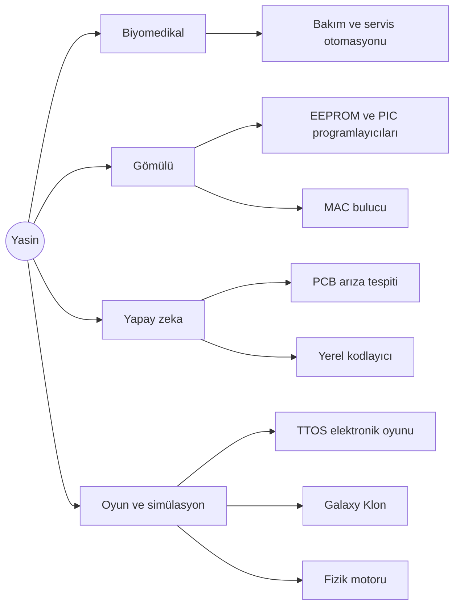

<div align="center">



**Hastane ortamı için otomasyon · gömülü elektronik · yapay zeka**

[Web sitem](https://yasinysr.github.io) &nbsp;·&nbsp; [Canlı demolar](https://yasinysr.github.io/#demo) &nbsp;·&nbsp; [E-posta](mailto:bme.yasinysr@gmail.com)

</div>

## Hakkımda

Ben Yasin, **biyomedikal mühendisiyim**. Hastane ortamındaki günlük işleri kolaylaştıran otomasyon sistemleri geliştiriyorum: tekrar eden kayıt ve rapor işlerini yazılıma devrediyor, elle yapılan adımları azaltıyorum. Tez çalışmamda **yapay sinir ağları, derin öğrenme ve makine öğrenmesiyle** ilgileniyorum.

<details>
<summary><b>Beni tanı</b> (tıkla)</summary>

```text
yasin@github
------------
Meslek : Biyomedikal Mühendisi
Alan   : otomasyon · gömülü · yapay zeka
Motto  : Daima bir adım geleceğe!
Site   : yasinysr.github.io
```

</details>

## Ne yapıyorum

Başlıklara tıklayıp aç.

<details open>
<summary><b>Otomasyon</b> · hastane iş akışları</summary>

<br>

- **Bakım ve servis otomasyonu:** bakım giriş ve teknik servis kayıtlarını telefondan toplayan, formları ve PDF'leri otomatik işleyen araçlar.

</details>

<details>
<summary><b>Gömülü elektronik</b> · ESP ve mikrodenetleyiciler</summary>

<br>

- **Programlayıcılar:** EEPROM (I²C, SPI, Microwire, 1-Wire) ve PIC programlama, DS2431 klonlama. ESP kendi Wi-Fi ağını açar, arayüz tarayıcıda çalışır.
- **MAC bulucu:** yerel ağdaki cihazların MAC adresini bulan küçük bir araç.

</details>

<details>
<summary><b>Yapay zeka</b> · görüntü ve yerel modeller</summary>

<br>

- **PCB arıza tespiti:** elektronik kartlardaki arızaları görüntü ve veriyle bulmaya çalışan, çevrimdışı çalışan bir yardımcı.
- **Yerel kodlayıcı:** internete bağlanmadan kendi bilgisayarımda çalışan, test doğrulamalı bir yapay zeka kod asistanı denemesi.

</details>

<details>
<summary><b>Oyun ve simülasyon</b> · öğrenerek eğlenmek</summary>

<br>

- **TTOS (elektronik oyunu):** transistörden başlayıp mantık kapıları, toplayıcılar ve hafıza üzerinden bir işlemciye uzanan, tarayıcıda çalışan bulmaca oyunu.
- **Galaxy Klon:** uzay oyunu denemesi.
- **Fizik motoru:** 2B fizik ve çarpışma denemesi.

</details>

> Projelerimin çoğu özel repolarda duruyor. Ayrıntı ya da demo için e-posta at.

## Haritam



## Tarayıcıda dene

Sitemde üç küçük demo gerçekten çalışıyor:

| Demo | Ne yapar |
| --- | --- |
| **Mantık atölyesi** | Anahtarlarla kapıları çalıştır, 4 bit toplayıcıyı kur |
| **Fizik sandbox** | Top bırak, fırlat, yerçekimini değiştir |
| **EKG atölyesi** | Normal, taşikardi, bradikardi ve atriyal fibrilasyon ritimleri |

**[yasinysr.github.io/#demo](https://yasinysr.github.io/#demo)**

## Açık repolar

| Repo | İçerik |
| --- | --- |
| [yasinysr.github.io](https://github.com/YasinYSR/yasinysr.github.io) | Kişisel sitem: WebGL arka plan, 3B küre, terminal, komut paleti, canlı demolar |
| [Python](https://github.com/YasinYSR/Python) | Küçük Python programları: hesap makinesi, Sezar şifreleme, yılan oyunu |
| [C_Language](https://github.com/YasinYSR/C_Language) | C dili örnekleri |


